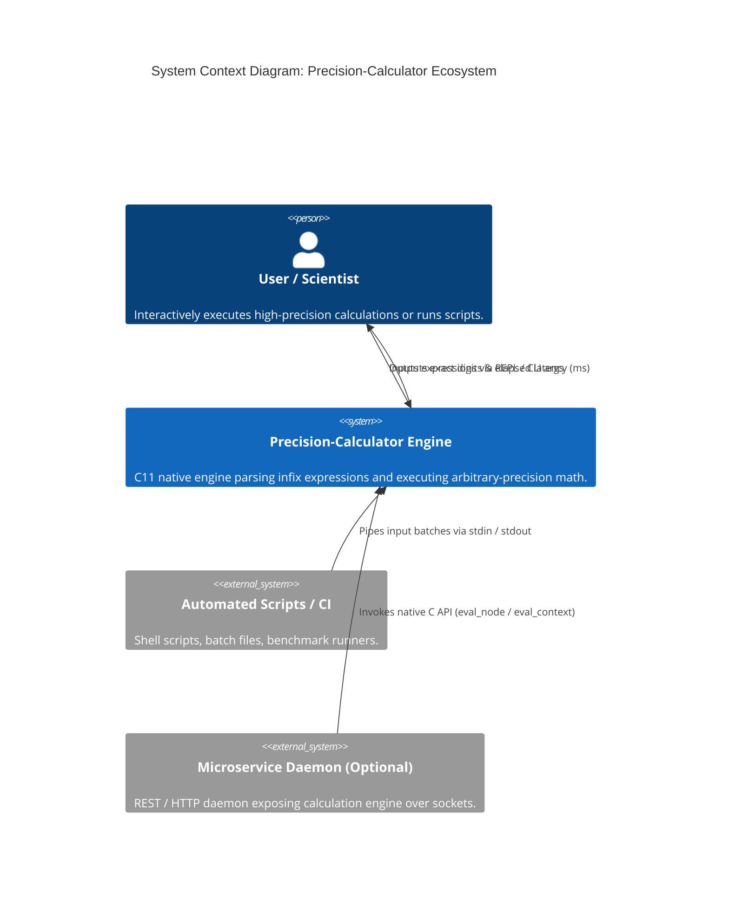
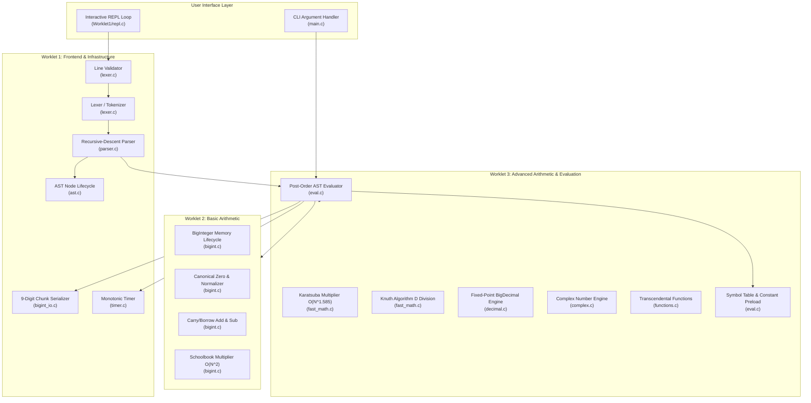
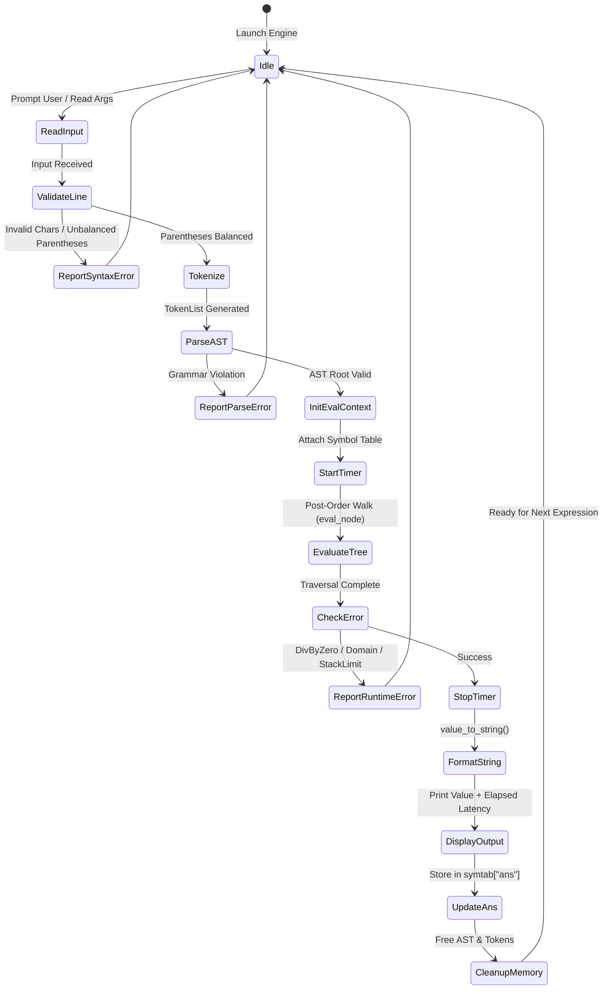
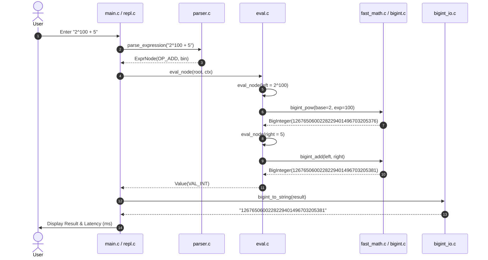
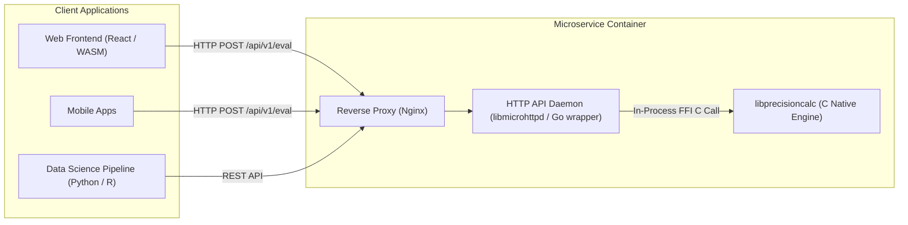

# High-Level Design (HLD) & System Architecture Document

**Project Name:** Arbitrary-Precision Calculator & Scientific Computing Engine  
**Project Identifier:** Precision-Calculator  
**Version:** 2.0.0  
**Document Classification:** System Architecture  

---

## 1. System Context & Architecture Overview

The **Precision-Calculator** system is architected as a modular, layered computational engine implemented entirely in ISO C11. It operates primarily as a standalone native CLI/REPL binary and an embeddable static/dynamic library (`libprecisioncalc`). Additionally, the engine supports headless batch execution, file scripting, and integration into networked services (via an HTTP microservice wrapper).

### 1.1 C4 Context Diagram (Level 1)

### 1.2 Architectural Principles
1. **Zero External Runtime Dependencies:** The calculation engine depends strictly on standard POSIX/ISO C runtime libraries (`libc`, `libm`). No GNU GMP, OpenSSL, or external framework is linked.
2. **Layered Separation of Concerns:** Divided into three autonomous worklets:
   * **Worklet 1 (Frontend):** Lexing, parsing, Abstract Syntax Tree (AST) construction, and terminal I/O.
   * **Worklet 2 (Primitive Core):** Base-$10^9$ limb representation, sign-magnitude representation, addition, subtraction, and schoolbook multiplication.
   * **Worklet 3 (Advanced Core & Runtime):** Karatsuba multiplication, Knuth Algorithm D division, fixed-point decimal arithmetic, complex numbers, transcendental functions, and post-order AST execution.
3. **Decoupled Data Contracts:** Information passes through clear boundaries as defined types:  
   $$\text{Raw String} \xrightarrow{\text{Lexer}} \text{TokenList} \xrightarrow{\text{Parser}} \text{AST (ExprNode)} \xrightarrow{\text{Evaluator}} \text{Value} \xrightarrow{\text{Renderer}} \text{Display String}$$

---

## 2. Container & Component Decomposition (C4 Level 2 & 3)

---

## 3. Technology Stack & Architectural Decisions (ADRs)

### ADR-001: Monolithic C Engine vs. Third-Party Math Libraries
* **Status:** Accepted.
* **Context:** Scientific software frequently relies on GNU GMP (`libgmp`) or MPFR for multi-precision calculations.
* **Decision:** Implement arbitrary-precision storage and all arithmetic algorithms from scratch in ISO C11.
* **Rationale:**
  * Complete control over memory layout, cache friendliness, and algorithm thresholds.
  * Zero external licensing encumbrances (LGPL issues avoided).
  * High portability across microcontrollers, embedded POSIX platforms, and bare-metal environments.

### ADR-002: Base-$10^9$ Multi-Limb Representation
* **Status:** Accepted.
* **Context:** Arbitrary-precision numbers can be represented in base-2 ($2^{32}$ / $2^{64}$), base-10 (BCD), or base-$10^9$.
* **Decision:** Represent big integers as an array of 32-bit limbs in base $B = 10^9$:
  $$\text{Value} = \text{sign} \times \sum_{k=0}^{N-1} \text{digits}[k] \times (10^9)^k$$
* **Rationale:**
  * **Overflow Prevention:** The maximum product of two base-$10^9$ limbs is $(10^9 - 1)^2 \approx 10^{18} < 2^{63}$, which fits safely into standard `uint64_t` accumulator variables without assembly-level carry flags.
  * **Fast I/O Conversion:** Packing and unpacking decimal characters involves only 9-digit chunk operations rather than expensive repeated binary division by 10.

### ADR-003: Tagged Union `Value` Hierarchy with Automatic Promotion
* **Status:** Accepted.
* **Context:** The calculator must support integers, fractional numbers, and imaginary values seamlessly.
* **Decision:** Encapsulate results in a tagged union `Value` supporting `VAL_INT`, `VAL_DEC`, and `VAL_COMPLEX`. Mixed-type operations automatically promote upwards:
  $$\text{BigInteger (VAL\_INT)} \longrightarrow \text{BigDecimal (VAL\_DEC)} \longrightarrow \text{Complex (VAL\_COMPLEX)}$$
* **Rationale:**
  * Prevents premature conversion of pure integers to floating-point approximations.
  * Allows exact results ($10! = 3628800$) to remain integers while fractional results ($10/4 = 2.5$) promote automatically to `BigDecimal`.

### ADR-004: Recursive-Descent AST vs. Shunting-Yard Queue
* **Status:** Accepted.
* **Context:** Infix expression evaluation can be performed using Dijkstra's Shunting-Yard algorithm (direct RPN stack) or a recursive-descent parser producing an AST.
* **Decision:** Build a full Abstract Syntax Tree (`ExprNode`) using recursive descent.
* **Rationale:**
  * Clean support for right-associative power operators ($2^{3^2}$).
  * Support for variable arity function calls (`gcd(a, b)`, `sin(x)`).
  * Accurate source code column tracking for syntax error carets (`^`).
  * Extensible to multi-statement execution, optimizations, and constant folding.

---

## 4. Pipeline Data Flow & State Machine

---

## 5. Subsystem Interaction Flows

### 5.1 Arithmetic Computation Lifecycle

---

## 6. Service Topology & Microservice Integration (Extension)

For cloud or networked microservice deployment, the native engine is exposed via a lightweight HTTP daemon wrapper:

* **Process Concurrency:** Thread-safe execution is achieved by providing each thread or worker process with its own allocated `EvalContext` and isolated `SymbolTable`.
* **State Management:** Stateless across REST requests; optional session cookies map to server-side cached symbol tables.
* **Failure Isolation:** Worker processes running evaluations operate under CPU timeout alarms (`setitimer`) and virtual memory limits (`RLIMIT_AS`) to guard against malicious recursive expressions.
