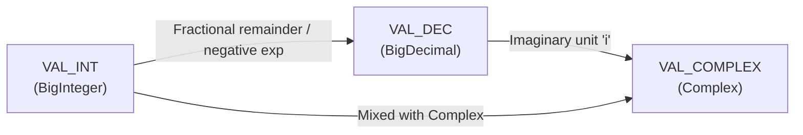
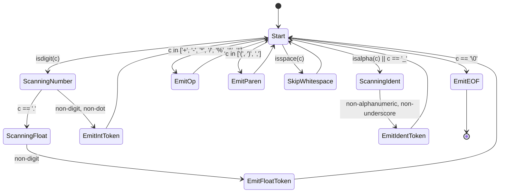
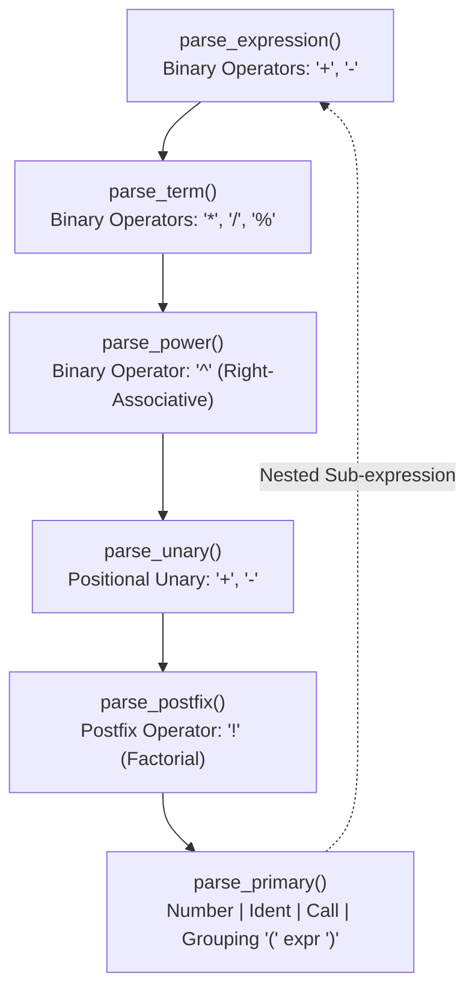

# Low-Level Design (LLD) & Technical Design Document (TDD)

**Project Name:** Arbitrary-Precision Calculator & Scientific Computing Engine  
**Project Identifier:** Precision-Calculator  
**Version:** 2.0.0  
**Document Classification:** Technical Design & Implementation Specification  

---

## 1. Concrete Data Structures & Memory Layouts

### 1.1 `BigInteger` (Worklet 2)
The fundamental multi-precision integer representation stores coefficients in base $B = 10^9$.

```c
typedef struct {
    int        sign;     // Sign indicator: +1 (positive), -1 (negative), 0 (canonical zero)
    size_t     size;     // Number of valid limbs actively in use (least-significant first)
    size_t     capacity; // Total allocated limb capacity in heap buffer
    uint32_t  *digits;   // Dynamically allocated array of base-10^9 limbs (0 <= limb < 10^9)
} BigInteger;
```

#### Memory Layout
```
Memory Address: [ Low Address .................................... High Address ]
Limb Index:     digits[0]        digits[1]        digits[2]        ... digits[size-1]
Significance:   10^0 to 10^8     10^9 to 10^17    10^18 to 10^26   ...
Base:           Base-10^9        Base-10^9        Base-10^9        ...
```

* **Canonical Zero Invariant:** If the number equals zero, its representation is strictly normalized such that `sign = 0`, `size = 0`, and any existing limbs in `digits` are zeroes.
* **Limb Constraint:** For all $0 \le k < \text{size}$, $0 \le \text{digits}[k] < 1{,}000{,}000{,}000$.

---

### 1.2 `BigDecimal` & `Complex` (Worklet 3)
```c
typedef struct {
    BigInteger significand; // Unbounded integer payload
    int        scale;       // Base-10 scale factor: value = significand * 10^(-scale)
} BigDecimal;

typedef struct {
    BigDecimal real;        // Real component: a
    BigDecimal imag;        // Imaginary component: b (where z = a + bi)
} Complex;

typedef struct {
    BigInteger quotient;    // Integer quotient result
    BigInteger remainder;   // Remainder satisfying: dividend = divisor * quotient + remainder
} DivisionResult;
```

---

### 1.3 Unified `Value` Tagged Union (Worklet 1 & 3)
All operands, variables, and evaluation results are encapsulated inside a tagged union:

```c
typedef enum {
    VAL_INT = 0, // BigInteger variant
    VAL_DEC = 1, // BigDecimal variant
    VAL_COMPLEX = 2 // Complex variant
} ValueType;

typedef struct {
    ValueType type;
    union {
        BigInteger i;
        BigDecimal d;
        Complex    c;
    } as;
} Value;
```

#### Automatic Type Promotion Hierarchy


---

### 1.4 Lexer & Abstract Syntax Tree (AST) Nodes (Worklet 1)
```c
typedef enum {
    TOKEN_INT, TOKEN_FLOAT, TOKEN_IDENT,
    TOKEN_OP, TOKEN_LPAREN, TOKEN_RPAREN, TOKEN_COMMA, TOKEN_EOF
} TokenType;

typedef struct {
    TokenType type;
    char     *text; // Dynamically allocated lexeme string
    size_t    pos;  // 1-indexed character byte offset in input stream
} Token;

typedef struct {
    Token  *tokens;
    size_t  count;
    size_t  capacity;
} TokenList;

typedef enum {
    NODE_NUMBER, NODE_VAR, NODE_BINARY, NODE_UNARY, NODE_CALL
} NodeType;

typedef enum {
    OP_NONE = 0,
    OP_ADD, OP_SUB, OP_MUL, OP_DIV, OP_MOD, OP_POW,
    OP_POS, OP_NEG, OP_FACT
} OpCode;

typedef struct ExprNode {
    NodeType type;
    size_t   pos;
    union {
        Value number;
        char *var_name;
        struct { OpCode op; struct ExprNode *left, *right; } bin;
        struct { OpCode op; struct ExprNode *operand;      } un;
        struct { int fn_id; size_t argc; struct ExprNode **args; } call;
    } as;
} ExprNode;
```

---

### 1.5 Symbol Table & Evaluation Context (Worklet 3)
```c
typedef struct {
    char  *name;
    Value  value;
} Symbol;

typedef struct {
    Symbol *symbols;
    size_t  count;
    size_t  capacity;
} SymbolTable;

typedef struct {
    int          precision;  // Target fractional decimal digits
    AngleMode    angle_mode; // ANGLE_RADIAN or ANGLE_DEGREE
    RoundingMode rounding;   // Active rounding mode (ROUND_HALF_UP)
    SymbolTable *vars;       // Active symbol table pointer
    int          depth;      // Current recursion depth guard
    EvalError    error;      // Latched error diagnostic
} EvalContext;
```

---

## 2. Core Algorithm Specifications & Pseudocode

### 2.1 Multi-Limb Long Division: Knuth Algorithm D
Used in `bigint_divide()` in `Worklet3/fast_math.c`. Computes $Q = \lfloor U / V \rfloor$ and $R = U \bmod V$ where $U$ has $m+n$ limbs and $V$ has $n$ limbs ($n \ge 2$).

```
ALGORITHM Knuth_Algorithm_D(U, V) -> (Q, R):
    Input:  Dividend U = (u_{m+n-1} ... u_0)_B
            Divisor  V = (v_{n-1} ... v_0)_B, with v_{n-1} != 0 and n >= 2
    Output: Quotient Q = (q_m ... q_0)_B
            Remainder R = (r_{n-1} ... r_0)_B

    // Step D1: Normalization
    d = floor(B / (v_{n-1} + 1))
    u' = U * d   // Normalized dividend (length m + n + 1)
    v' = V * d   // Normalized divisor (length n, with v'_{n-1} >= B/2)

    // Step D2: Loop over quotient digits
    FOR j FROM m DOWNTO 0 DO:
        // Step D3: Estimate trial quotient digit q_hat
        numerator = u'_{j+n} * B + u'_{j+n-1}
        q_hat = floor(numerator / v'_{n-1})
        r_hat = numerator mod v'_{n-1}

        // Test and refine estimate
        WHILE q_hat == B OR (q_hat * v'_{n-2} > B * r_hat + u'_{j+n-2}) DO:
            q_hat = q_hat - 1
            r_hat = r_hat + v'_{n-1}
            IF r_hat >= B THEN BREAK

        // Step D4: Multiply and subtract
        u'_{j+n ... j} = u'_{j+n ... j} - q_hat * v'

        // Step D5: Test remainder & Step D6: Add back if borrow occurred
        IF borrow occurred THEN:
            q_hat = q_hat - 1
            u'_{j+n ... j} = u'_{j+n ... j} + v'

        q[j] = q_hat

    // Step D7: Denormalization
    Q = q
    R = u' / d
    RETURN (Q, R)
```

---

### 2.2 Karatsuba Divide-and-Conquer Multiplication
Used in `bigint_mul_karatsuba()` in `Worklet3/fast_math.c` when $\min(\text{size}_A, \text{size}_B) \ge 32$ limbs.

```
ALGORITHM Karatsuba_Multiply(A, B):
    Input:  BigInteger A, BigInteger B of size ~ n limbs
    Output: BigInteger Product P = A * B

    IF n < KARATSUBA_THRESHOLD (32 limbs) THEN:
        RETURN Schoolbook_Multiply(A, B)

    m = ceil(n / 2)
    // Split A = A1 * B^m + A0, B = B1 * B^m + B0
    A0 = A mod B^m,  A1 = floor(A / B^m)
    B0 = B mod B^m,  B1 = floor(B / B^m)

    // 3 Recursive Multiplications
    Z0 = Karatsuba_Multiply(A0, B0)
    Z2 = Karatsuba_Multiply(A1, B1)
    
    // Middle term: Z1 = (A0 + A1) * (B0 + B1) - Z0 - Z2
    S_A = A0 + A1
    S_B = B0 + B1
    Z1  = Karatsuba_Multiply(S_A, S_B) - Z0 - Z2

    // Recombine: P = Z2 * B^(2m) + Z1 * B^m + Z0
    P = (Z2 << (2 * m)) + (Z1 << m) + Z0
    RETURN P
```

---

### 2.3 Newton-Raphson Arbitrary-Precision Square Root
Implemented in `fn_sqrt()` in `Worklet3/functions.c`.

```
ALGORITHM Newton_Raphson_Sqrt(x, precision):
    Input:  BigDecimal x >= 0, target decimal precision
    Output: BigDecimal out = sqrt(x)

    IF x == 0 THEN RETURN 0
    IF x < 0  THEN RAISE DomainError

    guard_precision = precision + 8
    epsilon = 10^(-precision)

    // Initial seed guess via IEEE-754 double
    y_0 = (BigDecimal) sqrt((double) x)

    WHILE true DO:
        // Iteration: y_{k+1} = 0.5 * (y_k + x / y_k)
        div_val = decimal_div(x, y_k, guard_precision)
        sum_val = decimal_add(y_k, div_val)
        y_next  = decimal_div(sum_val, 2, guard_precision)

        diff = abs(y_next - y_k)
        y_k = y_next

        IF diff <= epsilon THEN BREAK

    RETURN decimal_round(y_k, precision, ROUND_HALF_UP)
```

---

### 2.4 Range-Reduced Trigonometric Sine: $\sin(x)$
Implemented in `fn_sin()` in `Worklet3/functions.c`.

```
ALGORITHM Arbitrary_Precision_Sin(x, precision):
    Input:  BigDecimal x (angle in radians), target precision
    Output: BigDecimal out = sin(x)

    guard_precision = precision + 12
    two_pi = 2 * math_const_pi(guard_precision)

    // Range reduction: x_red = x - round(x / 2pi) * 2pi in [-pi, pi]
    k = round(x / two_pi)
    x_red = x - k * two_pi

    x2 = x_red * x_red
    sum = x_red
    term = x_red
    epsilon = 10^(-guard_precision)

    FOR k = 1 TO 150 DO:
        denom = (2 * k) * (2 * k + 1)
        term = -term * x2 / denom
        sum = sum + term

        IF abs(term) <= epsilon THEN BREAK

    RETURN decimal_round(sum, precision, ROUND_HALF_UP)
```

---

## 3. Lexer & Parser State Machines

### 3.1 Lexer Finite State Machine (FSM)


### 3.2 Recursive-Descent Grammar Transition Hierarchy


---

## 4. Error Handling & Memory Ownership Contracts

### 4.1 Error Code Classifications
| Code | Enum Symbol | Origin | Resolution Behavior |
| :--- | :--- | :--- | :--- |
| `0` | `ERR_NONE` | Evaluator | Success, render result |
| `1` | `ERR_DIV_BY_ZERO` | Evaluator (`/`, `%`) | Abort, print "Division by zero" |
| `2` | `ERR_UNDEFINED_VAR`| Symbol Table | Abort, print "Undefined variable '...'" |
| `3` | `ERR_UNDEFINED_FUNC`| Symbol Table / Functions | Abort, print "Invalid function ID" |
| `4` | `ERR_INVALID_ARITY`| Parser | Abort, print "Incorrect argument count" |
| `5` | `ERR_TYPE_MISMATCH`| Evaluator | Abort, print "Incompatible operand types" |
| `6` | `ERR_DOMAIN` | Functions (`sqrt`, `ln`) | Abort, print "Mathematical domain violation" |
| `7` | `ERR_RECURSION_LIMIT`| Evaluator | Abort, print "Recursion depth limit exceeded" |
| `8` | `ERR_OVERFLOW` | Evaluator (`fact`, `pow`)| Abort, print "Exponent / index exceeds bounds" |
| `9` | `ERR_INTERNAL` | Memory / Heap | Abort, print "Memory allocation failure" |

### 4.2 Memory Ownership Rules
1. **Parser Ownership:** When an `ExprNode` is created, it takes full recursive ownership of its child subtrees. Calling `ast_free(root)` deallocates the entire hierarchy without leaving dangling pointer aliases.
2. **Value Container Lifecycle:**
   * `value_init(&v, type)` allocates type-specific default structures.
   * `value_free(&v)` deallocates inner limb arrays without freeing the `Value` struct itself.
   * `value_copy(&dest, &src)` performs an exact deep clone of the limb payload.
3. **Symbol Table Ownership:** `symtab_set()` duplicates the identifier string (`strdup`) and creates a deep copy of the `Value`. Calling `symtab_free()` releases all duplicated strings and stored values.
