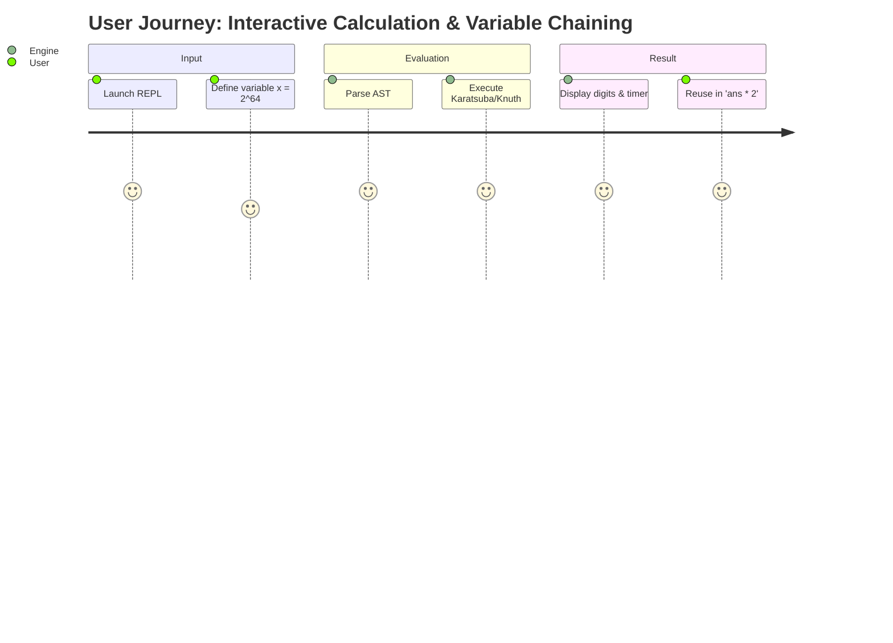

# Software Requirements Specification (SRS) & Product Requirement Document (PRD)

**Project Name:** Arbitrary-Precision Calculator & Scientific Computing Engine  
**Project Identifier:** Precision-Calculator  
**Version:** 2.0.0  
**Status:** Approved / Implemented  
**Author:** Department of Computer Science and Engineering, COEP Technological University  
**Target Environment:** ANSI C (C11) / POSIX.1-2008  

---

## 1. Executive Summary & Product Vision

### 1.1 Vision Statement
The **Arbitrary-Precision Calculator** is an industrial-grade, zero-dependency, arbitrary-precision numerical computing engine developed from first principles in ISO C11. It provides exact integer arithmetic, arbitrary-scale fixed-point decimal arithmetic, and complex number calculations across an interactive Read-Eval-Print Loop (REPL) and batch command-line interface. 

Unlike conventional calculators bound to IEEE 754 64-bit floating-point limitations (~15–17 decimal digits of precision) or relying on third-party libraries (such as GNU GMP or MPFR), this system implements its own memory allocation, base-$10^9$ limb packing, Karatsuba multiplication, Knuth Algorithm D division, and transcendental function approximations with guaranteed convergence.

### 1.2 Target Audience & Personas
* **Persona A (Scientific Researcher / Cryptographer):** Requires verifiable, unbounded integer and rational operations (e.g., $1000!$, 512-bit modular arithmetic, GCD) without floating-point inaccuracies or third-party license entanglements.
* **Persona B (Engineering Student / Educator):** Needs an intuitive CLI and REPL tool to evaluate complex infix expressions with variables, trigonometric functions, and execution timing metrics.
* **Persona C (Systems Engineer / Embedded Developer):** Seeks an embeddable, standalone C library with zero dynamic runtime dependencies and predictable memory bounds.

---

## 2. User Stories & Acceptance Criteria

### US-01: Arbitrary Precision Arithmetic
* **As a** researcher,  
* **I want to** evaluate arithmetic expressions with hundreds or thousands of digits,  
* **So that** calculations are exact and not truncated by machine word boundaries.  
* **Acceptance Criteria:**
  * **AC-01.1:** Integer additions, subtractions, and multiplications must yield exact results up to available system RAM.
  * **AC-01.2:** $100\text{-digit} \div 200\text{-digit}$ integer division must complete in $< 1.0\text{ second}$.
  * **AC-01.3:** Calculations must maintain canonical zero invariants (`sign = 0, size = 0`).

### US-02: Full Infix Expression Grammar
* **As an** engineer,  
* **I want to** write mathematical expressions using standard algebraic notation with operator precedence, parentheses, and unary signs,  
* **So that** I do not need to convert formulas to Reverse Polish Notation (RPN).  
* **Acceptance Criteria:**
  * **AC-02.1:** Standard precedence is respected: `()` > functions > `!` > unary `+`/`-` > `^` > `*`/`/`/`%` > binary `+`/`-`.
  * **AC-02.2:** Exponentiation (`^`) must be right-associative ($2\wedge 3\wedge 2 = 2\wedge (3\wedge 2) = 512$).
  * **AC-02.3:** Unary signs must be resolved contextually without backtracking.

### US-03: Dynamic Type Promotion
* **As a** user,  
* **I want to** mix integers, decimals, and imaginary units in the same expression,  
* **So that** operations automatically upgrade to the necessary numerical domain.  
* **Acceptance Criteria:**
  * **AC-03.1:** Mixed integer and decimal expressions promote to `BigDecimal`.
  * **AC-03.2:** Expressions involving the imaginary unit `i` promote to `Complex` ($a + bi$).
  * **AC-03.3:** Integer division with a non-zero remainder automatically promotes to `BigDecimal` evaluated to active precision.
  * **AC-03.4:** Negative integer powers ($2^{-3}$) automatically promote to `BigDecimal` ($0.125$).

### US-04: Transcendental & Scientific Functions
* **As a** mathematician,  
* **I want to** evaluate `sqrt`, `exp`, `ln`, `sin`, and `cos`,  
* **So that** I can solve non-linear equations with user-specified precision.  
* **Acceptance Criteria:**
  * **AC-04.1:** `sqrt(x)` must converge via Newton-Raphson iteration for $x \ge 0$.
  * **AC-04.2:** `sin(x)` and `cos(x)` must support degree and radian angle modes with modulo $2\pi$ reduction.
  * **AC-04.3:** Precision defaults to 20 decimal places and is reconfigurable via `:precision <N>`.

### US-05: Diagnostic Error Reporting
* **As a** developer,  
* **I want** exact character column positions when syntax or runtime errors occur,  
* **So that** I can pinpoint errors immediately.  
* **Acceptance Criteria:**
  * **AC-05.1:** Syntax errors must print a visual indicator (`^`) aligned to the offending character column.
  * **AC-05.2:** Domain errors (e.g., `ln(-1)`, `sqrt(-4)`) must return clear domain violation codes.
  * **AC-05.3:** Division or modulo by zero must abort cleanly without crashing or leaking memory.

---

## 3. Functional Requirements

| Requirement ID | Module | Description | Criticality |
| :--- | :--- | :--- | :--- |
| **FR-CORE-01** | `BigInteger` | Store unbounded integers as base-$10^9$ limbs in `uint32_t` dynamic arrays. | P0 |
| **FR-CORE-02** | `BigInteger` | Magnitude comparison in $O(1)$ size check, $O(N)$ limb check. | P0 |
| **FR-CORE-03** | `BigInteger` | Carry-propagating addition and borrow-propagating subtraction. | P0 |
| **FR-CORE-04** | `BigInteger` | Schoolbook multiplication ($O(N^2)$) for small limb counts. | P0 |
| **FR-CORE-05** | `FastMath` | Karatsuba divide-and-conquer multiplication ($O(N^{1.585})$). | P0 |
| **FR-CORE-06** | `FastMath` | Multi-limb long division based on Knuth Algorithm D with quotient normalization. | P0 |
| **FR-CORE-07** | `FastMath` | Binary exponentiation ($O(\log E)$) and Euclidean GCD ($O(\log(\min(A, B)))$). | P1 |
| **FR-DEC-01** | `BigDecimal` | Fixed-point decimal representation ($\text{significand} \times 10^{-\text{scale}}$). | P0 |
| **FR-DEC-02** | `BigDecimal` | Dynamic scale alignment for addition, subtraction, and comparison. | P0 |
| **FR-DEC-03** | `BigDecimal` | `ROUND_HALF_UP` tie-breaking rounding implementation. | P0 |
| **FR-CMP-01** | `Complex` | Complex arithmetic ($a + bi$) with `BigDecimal` real and imaginary components. | P1 |
| **FR-CMP-02** | `Complex` | Conjugate division: $(a+bi)/(c+di) = \frac{ac+bd}{c^2+d^2} + \frac{bc-ad}{c^2+d^2}i$. | P1 |
| **FR-FNC-01** | `Functions` | Precomputed constants accurate to 120+ digits: $\pi, e, \ln(10)$. | P0 |
| **FR-FNC-02** | `Functions` | Arbitrary-precision Newton-Raphson square root: $y_{k+1} = 0.5(y_k + x/y_k)$. | P0 |
| **FR-FNC-03** | `Functions` | Exponential function $\exp(x)$ via range splitting and Taylor series. | P1 |
| **FR-FNC-04** | `Functions` | Natural logarithm $\ln(x)$ via power-of-10 range reduction and series. | P1 |
| **FR-FNC-05** | `Functions` | Trigonometric $\sin(x)$ and $\cos(x)$ with modulo $2\pi$ reduction. | P1 |
| **FR-LEX-01** | `Lexer` | Pre-validation for character sets and balanced parentheses. | P0 |
| **FR-LEX-02** | `Lexer` | Tokenization with byte offset position tracking for numbers, identifiers, ops. | P0 |
| **FR-PAR-01** | `Parser` | Recursive-descent AST generation supporting standard operator precedence. | P0 |
| **FR-PAR-02** | `Parser` | Positional unary sign resolution without grammar backtracking. | P0 |
| **FR-EVL-01** | `Eval` | Recursive post-order tree evaluation with depth guard (`MAX_RECURSION_DEPTH = 128`). | P0 |
| **FR-EVL-02** | `Eval` | Automatic type promotion along $\text{VAL\_INT} \to \text{VAL\_DEC} \to \text{VAL\_COMPLEX}$. | P0 |
| **FR-SYM-01** | `SymbolTable`| Variable assignment (`x = expr`), retrieval, and constant preload (`pi`, `e`, `i`, `ans`). | P1 |
| **FR-RPL-01** | `REPL` | Interactive loop with timing reports and meta-commands (`:help`, `:exit`, `:precision`, `:mode`). | P1 |

---

## 4. Non-Functional Requirements (NFR)

### 4.1 Performance & Throughput
* **NFR-PERF-01 (Division Latency):** Division of a 100-digit number by a 200-digit number must complete in $< 1.0\text{ s}$ on a standard x86_64 or ARM64 workstation.
* **NFR-PERF-02 (Multiplication Scaling):** For inputs exceeding 32 limbs (288 decimal digits), multiplication must use Karatsuba divide-and-conquer to maintain sub-quadratic execution time ($O(N^{1.585})$).
* **NFR-PERF-03 (Measurement Accuracy):** Execution metrics must bracket arithmetic computation exclusively using monotonic high-resolution hardware timers (`clock_gettime(CLOCK_MONOTONIC)`).

### 4.2 Memory & Resource Constraints
* **NFR-MEM-01 (Zero Memory Leaks):** All heap-allocated limbs, token strings, and AST nodes must be freed recursively. No memory leaks under Valgrind Memcheck (`--leak-check=full`) and AddressSanitizer.
* **NFR-MEM-02 (Limb Density):** Base-$10^9$ packaging must store 9 decimal digits per 32-bit integer limb, achieving $> 99\%$ memory compactness compared to naive single-byte digit storage.
* **NFR-MEM-03 (Recursion Guard):** AST evaluation must limit recursive descent to 128 stack frames, rejecting pathological expressions (e.g. $1+(1+(1+\dots))$) with `ERR_RECURSION_LIMIT` instead of triggering a segmentation fault.

### 4.3 Security & Robustness
* **NFR-SEC-01 (Buffer Overflow Protection):** No fixed-size stack buffers for unbounded user expressions. Dynamic buffers must be allocated and resized via geometric reallocation.
* **NFR-SEC-02 (Defensive Arithmetic):** Division by zero, modulo by zero, negative radicands, non-positive logarithms, and factorial bounds ($n > 10000$) must trigger explicit error returns rather than undefined behavior.
* **NFR-SEC-03 (Compiler Hardening):** Source code must compile warning-free under `-Wall -Wextra -pedantic -std=c11` across GCC and Clang.

### 4.4 Portability & Dependencies
* **NFR-PORT-01 (Zero Third-Party Dependencies):** The code must link strictly against standard C runtime libraries (`libc`, `libm`). No GNU GMP, MPFR, or OpenSSL dependencies.
* **NFR-PORT-02 (Cross-Platform Execution):** Target environments include macOS (Darwin ARM64/x86_64), Linux (glibc/musl), and Windows (MinGW-w64).

---

## 5. Acceptance Test Matrix

| Test ID | Input Expression | Expected Output | Verification Method |
| :--- | :--- | :--- | :--- |
| **TC-ACC-01** | `2 + 3 * 4` | `14` | Precedence verification |
| **TC-ACC-02** | `2 ^ 3 ^ 2` | `512` | Right-associativity verification |
| **TC-ACC-03** | `10 / 4` | `2.50000000000000000000` | Auto-promotion to `BigDecimal` |
| **TC-ACC-04** | `2 ^ (-3)` | `0.12500000000000000000` | Negative exponent promotion |
| **TC-ACC-05** | `(2 + 3*i) * (4 + 5*i)` | `-7 + 22i` | Complex arithmetic validation |
| **TC-ACC-06** | `gcd(48, 18)` | `6` | Euclidean GCD verification |
| **TC-ACC-07** | `fact(10)` | `3628800` | Factorial calculation |
| **TC-ACC-08** | `sqrt(144)` | `12.00000000000000000000` | Newton-Raphson square root |
| **TC-ACC-09** | `sin(pi / 2)` | `1.00000000000000000000` | Trigonometric constant evaluation |
| **TC-ACC-10** | `exp(1)` | `2.71828182845904523536` | Exponential series evaluation |
| **TC-ACC-11** | `10 / 0` | Error: `Division by zero` | Exception / error handling |
| **TC-ACC-12** | `ln(-5)` | Error: `Domain error` | Domain guard verification |
